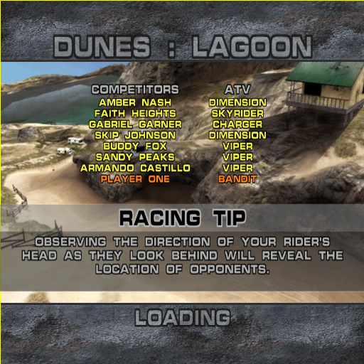
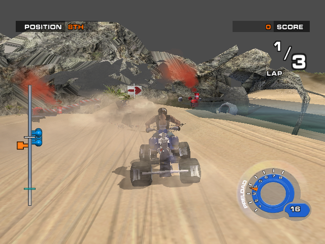

# ATV Quad Power Racing 2 - Build & Install Wizard

This is a **source package**, not a game executable distribution. It contains the generated C/CMake project and the matching `xboxrecomp-main` source required to build the current tested Release variant. It does not contain the original game image, XBE, BAH/BAD archives, or other copyrighted game data.

## Quick start

1. Extract this package anywhere on a Windows 10/11 x64 PC.
2. Double-click **Install Wizard.bat**.
3. The wizard checks CMake 3.20+ and Visual Studio 2022 C++ Build Tools with a Windows SDK before extracting or building anything. If a prerequisite is missing, click **Install missing prerequisites** and approve the official Kitware/Microsoft installers when prompted. Visual Studio may need several GB, an internet connection, and administrator/UAC approval.
4. If your legally obtained game backup is inside a ZIP/7z, unpack it first until you have the Xbox XISO image. In the wizard, browse to the `.iso`/`.xiso` file and choose **Extract XISO & Build Release**.
5. The wizard extracts the XISO into the initially empty `game/` folder, checks for `default.xbe`, `ATV.bah`, and `ATV.bad`, then builds the source project in `project/`. It places the newly built `my_xbox_game.exe` at the package root. The first extraction/build is commonly around 12-20 minutes depending on the PC; installing build tools may take longer.
6. After a successful build, choose whether to create a desktop shortcut. If an `.ico` file has been placed in `icon/`, the shortcut uses it; otherwise it uses the executable icon.
7. Launch with **Run ATV QPR2.bat**. It starts from the package root so the runtime reads `game/default.xbe` and the original game files.

The wizard does **not** unpack `ATV.bah` or `ATV.bad` into loose assets. The game opens those original archives itself, and the runtime palette support is part of the compiled engine. The installer preserves the XISO-extracted archives and does not rewrite them. The Bark extractor and Asset Browser/mesh tools are included for optional developer inspection only; they are not prerequisites and are not part of the normal install path.

## Replaceable build project

The whole `project/` folder is the version-matched build input. To update the build in a future release, replace that folder with a compatible project folder that preserves `project_manifest.json` schema version 1 and its relative CMake-source/engine paths, target, and output fields. The wizard and root `game/` data layout stay the same. Do not replace only one of the game-project or engine-source trees with a mismatched version.

The manifest currently builds `project/game_project` together with `project/xboxrecomp-main`, using the Visual Studio 2022 x64 generator and the Release configuration. `wizard/Build-Project.ps1` is also available for direct command-line builds after prerequisites are installed.

## Optional asset inspection tools

The scripts in `tools/` can extract indexed stored blocks from the game archives and run the same wrapper/LZSS decoder used by `ATV_Asset_Browser.py`. They write supplemental files under `game/assets/`; they do not modify the runtime archives. See [`tools/README.md`](tools/README.md). Python 3 with Tk support is needed only for these optional tools; Pillow and NumPy enable optional GUI features.

## Rights and third-party software

You must provide your own legally obtained copy of ATV Quad Power Racing 2. This project is an independent recompilation effort and is not endorsed by Microsoft or the game publisher. No game data is included here. The bundled XISO utility is XboxDev `extract-xiso` release `build-202609111233`; its license and required acknowledgement are included under `licenses/extract-xiso/` and in `THIRD_PARTY_NOTICES.md`. The `xboxrecomp-main` source includes its own license/notices. Review applicable rights and licenses before redistributing changes.

## Generated and local files

The root `.gitignore` excludes the extracted `game/` data, local build output, logs, temporary staging, backups, and the generated game executable. The project source and build wizard remain available to commit or upload; no Git commit or upload is performed by this package.

  
  

