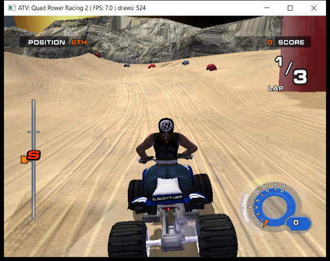

# ATV Quad Power Racing 2 — Xbox Recompilation / D3D11 Bring-up

This repository contains the Windows x64 host project and the `xboxrecomp-main` runtime source used for the current ATV Quad Power Racing 2 recompilation bring-up. It is an experimental project toward a working native decompilation/recompilation; it is **not** a claim that the full game is complete, fully native, or free of rendering/compatibility issues.

The current share snapshot is the source set used for the D3D11 Records-screen investigation on 2026-10-31. It includes an opt-in renderer trace (`RECOMP_D3D_PANEL_TRACE`) that records textured draws, texture metadata and decoded-cache hashes, bound SRV status, blend/depth/alpha state, and combiner words.

## Contents

- `game_project/` — project CMake definition, host entry point, compatibility and manually supplied function sources, generated recompilation code, and an intentionally empty `game/` directory with an asset note.
- `game_project/src/recomp/gen/` — generated C translation units and headers required directly by this build. These are included so a recipient can compile without repeating the recompilation pipeline.
- `xboxrecomp-main/` — vendored toolkit source used by the tested build, including the matching D3D11 backend source and its license/notices.
- `install_build.ps1` — portable Windows configure/build helper; it resolves the toolkit path relative to this repository.
- `run_records_panel_trace.bat` — runs the built diagnostic with the D3D11 panel trace enabled and logs to `logs/`.

The repository intentionally omits the original XBE, game archives/media, copyrighted runtime assets, local executables/PDBs, and local build directories. It also omits the optional toolkit conformance `.xbe` fixture. No game data is needed to compile; a complete legally obtained game directory is needed to run the host.

## Requirements

- Windows 10/11, x64.
- CMake 3.20 or newer.
- Visual Studio 2022 or Visual Studio 2022 Build Tools, with **Desktop development with C++** and a Windows SDK installed.
- Enough free space for generated compiler objects and the build tree; the source snapshot itself is approximately 121 MB uncompressed.

The setup script configures and builds the project; it does **not** download or install CMake, Visual Studio, or the Windows SDK.

## Build

Extract/clone the repository, open PowerShell in its root, and run:

```powershell
powershell -NoProfile -ExecutionPolicy Bypass -File .\install_build.ps1
```

By default the script configures an x64 Visual Studio 2022 `RelWithDebInfo` build and creates:

```text
build/RelWithDebInfo/my_xbox_game.exe
```

Choose another supported configuration or build directory if needed:

```powershell
.\install_build.ps1 -Configuration Release -BuildDirectory .\build-release
```

The script passes the repository's bundled `xboxrecomp-main/` path to CMake. It checks that CMake, the project/toolkit CMake files, and the generated recomp sources are present, then configures and builds the `my_xbox_game` target. If CMake reports a missing compiler or Windows SDK, install the VS 2022 C++ workload and SDK and rerun the script.

## Run the diagnostic build

The executable loads `game/default.xbe` and redirects game file I/O to the `game/` directory. Before launch, put your **own legally obtained** game files into `game_project/game/` with the expected directory layout, including `default.xbe` and the game's data files. This repository does not contain those files.

After a successful default build, run:

```text
run_records_panel_trace.bat
```

The launcher selects the direct D3D11 backend, keeps normal depth and combiner behavior enabled, and sets `RECOMP_D3D_PANEL_TRACE=1`. Navigate to Track Select, leave the Records panels visible, then close the game normally. The log is written to `logs/records_panel_trace.log`. The trace is read-only and bounded (up to 4,096 matching entries); disabling the environment flag leaves the additional trace silent.

## Records-panel format bug and fix (2026-10-31)

The earlier broad trace produced candidate overlay textures `0x8251C000` (a numbered atlas) and `0x82505000` (a small mask), but neither alone explained the white cards. A focused A/B run identified six valid 256×128 Records render-target images (`0x82721000`, `0x82741000`, `0x82761000`, `0x82781000`, `0x827A1000`, and `0x827C1000`). Bypassing only the generated combiner made the card artwork visible while raw-texture and depth overrides remained disabled, isolating the issue to combiner handling rather than missing source pixels or depth state.

The root cause was an alpha-only format misclassification in `xboxrecomp-main/src/nv2a/nv2a_backend_d3d11.c`: NV097 color-size `0x06` is full-color `A8R8G8B8`, not alpha-only. Alpha-only `A8` is `0x19`. The generated combiner intentionally forces sampled RGB to white for alpha-only textures, which erased the color of these full-color render targets. The D3D11 backend now checks `NV097_SET_TEXTURE_FORMAT_COLOR_SZ_A8` (`0x19`) and retains normal combiner rendering. The corrected Windows target compiled successfully, and the user confirmed the Records panels were visible during milestone validation.

This is a targeted rendering fix, not a claim that the full game is complete. Other texture/rendering glitches and the reported in-race stability issue remain open. Run-specific logs, screenshots, and user game data are not included in this repository.

## Development status

### Completed and verified in this snapshot

- Established a Windows x64 CMake build for the generated ATV Quad Power Racing 2 recompilation project and bundled the required `xboxrecomp` source.
- Added `install_build.ps1` and `run_records_panel_trace.bat` for repeatable setup/build and a bounded D3D11 diagnostic run.
- Fixed the Track Select Records panels rendering white. The backend now treats NV097 format `0x06` as full-color A8R8G8B8 and reserves the alpha-only RGB override for A8 (`0x19`). The targeted build succeeded and the user verified the panels reappeared.
- Recorded source provenance, prerequisites, game-file requirements, and third-party rights guidance in this README.

### Race-scene work now included (diagnostic; visual issues remain)

This snapshot now includes the latest build-critical D3D11/kernel sources used by the isolated Windows `RelWithDebInfo` build, including vertex-interpreter optimizations and the test-only safe-point path for NV2A software method 5. The interrupt path and renderer experiments remain diagnostic: repeated fence cycles and PMC re-enable behavior are not fully validated, and the diagnostic settings are not enabled by the normal launcher.

- The race can progress past the previously observed 0-FPS fence wait with the isolated safe-point test path, but this is not yet a production-ready or generally verified interrupt implementation.
- A D3D11 render-target binding-cache invalidation fix is included. It compiled successfully, but the post-change capture still shows terrain/rock layering artifacts and a black/gray sky; the change is **not** claimed to fix occlusion.
- The traced title alternates two 640x480 guest color buffers (`0x001B0000` and `0x00084000`), while the direct D3D11 route maps both to the same host backbuffer. Correct presentation and zeta/depth-buffer pairing need further investigation before changing the route.
- Race traces show depth testing is commonly enabled with `LEQUAL` and writes enabled, and the 640x480 surface receives a depth clear. This narrows the investigation but does not prove the correct DSV is paired to every guest surface or that all transformed depth values are correct.
- Distant rider/ATV visibility, shadow-card blending/alignment, sky rendering, and the transient model-loading grid artifact remain unresolved. Earlier fog, alpha, and actor-depth A/B tests did not establish fixes.

Do not enable the test-only interrupt or rendering overrides in a normal build without repeat-fence testing, a controlled visual A/B, and regression checks.

## Race-scene screenshots (2026-10-31)

These are separate diagnostic captures from different race moments, not a controlled before/after comparison. They show current rendering progress and known remaining artifacts; they are not evidence that the depth/occlusion or sky problems are fixed.




## Remaining development roadmap

1. Add a race-scene-specific, one-shot capture trigger so screenshots align with candidate actor draws after the user reaches the race; identify rider, ATV, shadow, and LOD batches from synchronized images and trace records.
2. Determine why distant AI rider meshes disappear while nearby models remain visible; test texture/combiner, alpha, depth, culling, LOD, and draw-distance hypotheses one variable at a time.
3. Fix shadow-card blending and rider-to-shadow screen-space alignment without breaking other transparent effects.
4. Reproduce and diagnose the transient grid pattern during model loading/transitions.
5. Build and run the distributable snapshot after each candidate fix, compare against the known-good Records-panel screen, then update this README, the handoff, and the share bundle only for verified milestones.
6. Continue broader game compatibility work: remaining game systems, input/audio/runtime edge cases, track/gameplay validation, and performance/stability remain outside the verified Records-panel fix.

## Investigation handoff

[`D3D11_HANDOFF.md`](D3D11_HANDOFF.md) carries the ongoing renderer investigation: the confirmed Records-panel fix, safe-point method-5 test and its caveats, depth/target-routing evidence, unresolved shadow/rider/sky/grid issues, and recommended next steps. It is a working project handoff, not a claim of completion. The two selected screenshots are included for context; raw logs, local executable builds, and the user's game files remain excluded.

## Troubleshooting

- **`cmake` is not found:** install CMake 3.20+ and ensure it is on `PATH`.
- **Visual Studio generator/compiler/SDK error:** install VS 2022 Build Tools with the C++ desktop workload and Windows SDK.
- **Executable builds but will not start the game:** confirm that the recipient-supplied `game_project/game/default.xbe` and required assets exist. Compilation alone does not validate runtime assets.
- **No `[D3D11-PANEL]` lines:** use `run_records_panel_trace.bat`, confirm that the active build includes the vendored `nv2a_backend_d3d11.c`, and reach a supported 4:3 render surface.
- **Trace cap reached before the relevant scene:** the current cap is 4,096 entries; use a focused follow-up run rather than inferring panel ownership from full-screen draws.

## Provenance and rights

The generated recompilation sources are included because this CMake target compiles them directly; regenerating them requires the original game binary and recompilation workflow. The game binary and game assets are not included. The vendored toolkit's license/notices are in `xboxrecomp-main/`. This repository does not grant rights to the game or any third-party material; check the relevant rights and licenses before reuse or redistribution.

## Project intent

The parent project goal is a working native decompilation/recompilation of ATV Quad Power Racing 2 using `xboxrecomp`. The current snapshot is an intermediate Windows D3D11 backend diagnostic build, not a release build or a finished game port.


## Current race-scene status (2026-11-01)

The captured 512×512 surface `0x82809000` is the Dunes Lagoon **loading card**, not the live race sky. See [the captured loading target](screenshots/loading-target-82809000-20261101.png). A separate race frame shows the gray sky and white square sun; another 3250-draw test frame shows black sky and incomplete background geometry. These are different moments, not a controlled A/B: [gray sky / white square](screenshots/race-gray-sky-white-square-20261101.png), [3250-draw race frame](screenshots/race-max-draws-3250-20261101.png).

`RECOMP_D3D_MAX_DRAWS=3250` was tested only in an isolated diagnostic run. Its reported race intervals were 6.40, 5.16 and 6.50 FPS, with about 751 draws/frame—below the configured cap. This does not establish a performance benefit or validate the user's “sweet spot” impression; the value is not applied to the normal launcher. Frame dumping and the method-5 test path also make this unsuitable as a clean benchmark.

The package source now includes format-aware guest Z16/Z24S8 depth/stencil clears and opt-in target/zeta diagnostics. It builds without bundled game assets; these changes are **not** claimed to fix terrain occlusion, sky, or distant-rider visibility. The unverified signed reciprocal-W shader experiment is intentionally excluded. The scoped handoff records exact evidence and next steps in [`D3D11_HANDOFF.md`](D3D11_HANDOFF.md). The repository still omits game binaries, assets, local executables, and build outputs.


## Build validation (2026-11-01)

The repository's `install_build.ps1` completed successfully for `RelWithDebInfo` without any game assets, using an external build directory under the local `.work` area. The first package attempt exposed a missing `Nv2aRenderState.zeta_format` declaration; after syncing the matching backend header, the build succeeded. MSVC still reports existing warnings, but no compile errors. The resulting executable and all build files are intentionally excluded from this repository.
